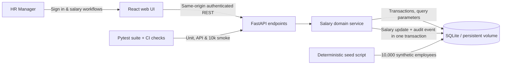

# Architecture at a glance

## Why this layering?

- UI concerns (forms, navigation, display) are separate from compensation rules and SQL persistence.
- The money parser enforces exact amounts; the salary service owns transaction and version checks.
- The HTTP adapter maps domain errors into 404, 409, and 422 responses.
- Currency-scoped analytics avoid misleading business conclusions.
- Deployment uses one self-contained service and a persistent database mount; horizontal scaling requires PostgreSQL and an enterprise identity provider.

**Non-production caveats:** single administrator and SQLite rather than a managed relational store. The new React 19 bundle and Render deployment must be built and verified before submission. See `DESIGN.md` and `DEPLOY_RENDER.md`.
